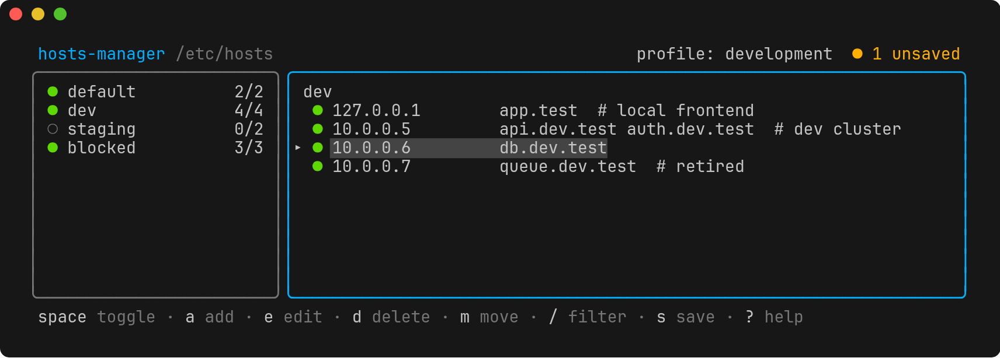

# hosts-manager

[](https://github.com/brandonhon/hosts-manager/releases)
[](https://github.com/brandonhon/hosts-manager/actions)
[](LICENSE)

Manage your hosts file from the command line or an interactive editor, on Linux,
macOS and Windows. Entries are grouped into categories you can switch on and off
together, profiles switch several categories at once, and every change is backed
up first.



## Install

Download the archive for your platform from the
[releases page](https://github.com/brandonhon/hosts-manager/releases) and put
`hosts-manager` on your `PATH`:

- **Linux and macOS:** `tar -xzf hosts-manager-*.tar.gz hosts-manager && sudo install -m 0755 hosts-manager /usr/local/bin/`
- **Windows:** extract `hosts-manager.exe` from the `.zip` into a folder on your `PATH`.

[docs/install.md](docs/install.md) has complete steps for each platform,
including checksum verification, building from source, and uninstalling.

## Quick start

```bash
sudo hosts-manager                                   # open the interactive editor
hosts-manager list                                   # entries, grouped by category
sudo hosts-manager add 10.0.0.5 api.dev.test -c dev  # add an entry to a category
sudo hosts-manager add 0.0.0.0 ads.example.com -c blocked
sudo hosts-manager disable -c dev                    # switch a whole category off
sudo hosts-manager restore 1                         # undo: restore the newest backup
```

Changing the hosts file needs `sudo` (an Administrator terminal on Windows);
reading it does not, and `--dry-run` shows what a change would do without
making it. Every change is backed up first.

## Documentation

- [Installing](docs/install.md): Linux, macOS, Windows, from source
- [Using hosts-manager](docs/usage.md): every command and the interactive editor
- [Configuration](docs/configuration.md): the config file, where data lives,
  and how the hosts file is laid out

## Contributing

See [CONTRIBUTING.md](CONTRIBUTING.md). Release notes are on the
[releases page](https://github.com/brandonhon/hosts-manager/releases);
[CHANGELOG.md](CHANGELOG.md) covers versions up to 0.7.0.

## License

[MIT](LICENSE)
