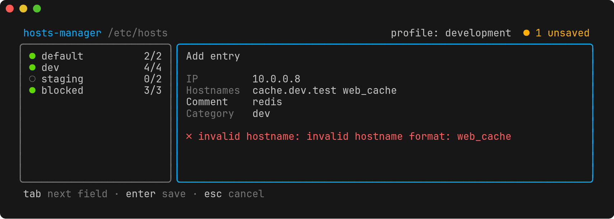
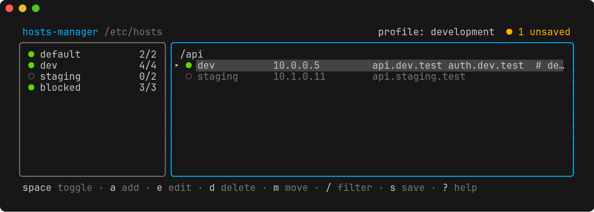

# Using hosts-manager

Every command, its flags, and the interactive editor. For installing, see
[install.md](install.md); for the config file and where data lives, see
[configuration.md](configuration.md).

## Privileges

Every command that changes the hosts file, and the interactive editor, must run
elevated: `sudo` on Linux and macOS, an Administrator terminal on Windows.
Without it the command refuses before doing anything. Reading (`list`,
`export`, `profile` and `restore` with no argument, `config`, `backup`) works as
a normal user, and so does `--dry-run`, which shows what a change would do without
writing anything.

Under `sudo`, config, backups and the audit log still belong to you: they live
in your home directory and are owned by your user, not root.

## Commands

```
hosts-manager                         open the interactive editor
hosts-manager list [query] [-c cat] [-a]
hosts-manager add <ip> <host>... [-c cat] [-m comment]
hosts-manager rm <host>
hosts-manager enable  <host> | -c <cat>
hosts-manager disable <host> | -c <cat>
hosts-manager profile [name]
hosts-manager backup
hosts-manager restore [number | file]
hosts-manager export [-f json|yaml|hosts] [-o file] [-c cat]
hosts-manager import <file> [-f json|yaml] [--merge]
hosts-manager config
```

Global flags: `--dry-run`, `-v/--verbose`, `--version`, `-h/--help`. Every
command has `--help`, and a command given the wrong arguments or flags prints
its help after the error. `-v` is `--verbose`, not the version: on its own it
prints this help.

## Entries

```bash
sudo hosts-manager add 127.0.0.1 myapp.local                    # into the default category
sudo hosts-manager add 10.0.0.5 api.dev web.dev -c dev -m "dev box"
sudo hosts-manager add 0.0.0.0 ads.example.com -c blocked       # block a host
sudo hosts-manager disable myapp.local                          # comment it out, keep it
sudo hosts-manager enable myapp.local
sudo hosts-manager rm myapp.local                               # the line goes when it has no other hostnames
```

A category is created the first time you add to it; its name may use letters,
digits, `-` and `_`. Hostnames must be valid RFC 1123 names, and multicast
addresses are rejected.

## Listing and searching

```bash
hosts-manager list              # everything enabled, grouped by category
hosts-manager list -a           # include disabled entries
hosts-manager list api          # entries whose IP, hostname or comment contains "api"
hosts-manager list -c dev       # one category
```

## Categories and profiles

```bash
sudo hosts-manager disable -c staging    # comment out a whole category
sudo hosts-manager enable -c staging
hosts-manager profile                     # list profiles; * marks the active one
sudo hosts-manager profile development    # enable exactly its categories, disable the rest
```

Profiles are defined in the config file (see below).

## Backups

With `auto_backup` on (the default), the hosts file is backed up before every
change. You can also back it up by hand:

```bash
hosts-manager backup
hosts-manager restore             # list backups, newest first
sudo hosts-manager restore 1      # restore the newest
sudo hosts-manager restore hosts.backup.2026-11-19T15-04-05.gz
```

Restoring backs up the current file first, so a restore can itself be undone.
The newest `max_backups` are kept, and backups older than `retention_days` are
removed.

## Export and import

```bash
hosts-manager export -f yaml -o my-hosts.yaml
hosts-manager export -f hosts -c dev                # print one category as hosts lines
sudo hosts-manager import my-hosts.yaml             # replace all entries
sudo hosts-manager import more.json -f json --merge # add to the existing entries
```

Every imported entry is validated before anything is written; one bad entry
rejects the whole file.

## Interactive editor

Run `hosts-manager` with no arguments (with `sudo`, or `--dry-run` to look
around). Categories are on the left with their enabled/total counts; the
selected category's entries are on the right. The top bar shows the active
profile and how many changes are unsaved.

| Key | Action |
|---|---|
| `tab`, `←` `→` | switch pane |
| `↑` `↓` / `k` `j`, `pgup` `pgdn`, `g` `G` | move, page, top, bottom |
| `space` | enable/disable the entry, or the whole category in the left pane |
| `t` | enable/disable the whole category |
| `a`, `e`, `d` | add, edit, delete an entry |
| `m` | move the entry to another category |
| `/`, `esc` | filter every category by IP, hostname or comment; clear it |
| `p` | activate a profile |
| `s` | save |
| `?` | all keys |
| `q` | quit; asks first if there are unsaved changes |



Add and edit check each field as you type, with the same rules as the command
line. Typing a new name in the category field creates that category. Nothing
is written until you press `s`; saving takes a backup and records the change in
the audit log, like any other command. In a terminal narrower than 80 columns
the category pane is hidden and `←` `→` switch category instead.


